# konex — feature guide

A tour of the game in pictures: what each part is, why it exists, and how it fits the whole. konex is **Joshua B. Bussdieker's** 2005 C++/OpenGL space-combat game (copyright headers "© 2005 by Joshua B. Bussdieker", GPL version 2 or later, see `COPYING`). Its Windows build calls itself **Conex**, and its logo and icon are `data/logos/conex.tga` and `data/icons/Conex.ico`; on Linux and macOS it calls itself **Konex**. The title bar says V0.9.5 (`SYS_APPVERSION` in `src/defs.h`).

> **How the pictures were made.** Pictures 1–9 are live: the `macos-port` branch was built on 2026-10-20 on Alpine Linux (aarch64, GCC 15.2, Mesa llvmpipe, no GPU) with the repository's own CMake build, run under XWayland, driven with `xdotool` and captured with ImageMagick's `import`. Nothing in the source or data was changed. Picture 10 is the repository's own sprite files laid out on one sheet; picture 11 is the real terminal output of that build, set as a page and screenshotted. Where the game had to be coaxed (the arrow keys, see [part 3](#part-3)), the guide says so.

## Contents

1. [The front door: the menu over the Conex logo](#part-1)
2. [Two scenes: Team Deathmatch and Sunday Drive](#part-2)
3. [Flying: thrust, turn, drift, and the arrow-key problem](#part-3)
4. [Combat: missiles, targets, frags and respawns](#part-4)
5. [Three teams of computer pilots](#part-5)
6. [The window system: map, HUD, target, frame rate](#part-6)
7. [Picking a ship](#part-7)
8. [The console](#part-8)
9. [Data, not code: XML and TGA files](#part-9)
10. [What was left unfinished in 2005](#part-10)
11. [Building it: 2005 Autotools to the 2026 port](#part-11)
12. [How it fits together](#part-12)

## 1. The front door: the menu over the Conex logo

**Why it exists.** A game needs somewhere to start, choose a mode and quit. konex draws that place itself, in OpenGL, rather than with a toolkit, so the same menu works on X11, Win32 and (now) SDL2.

**How it fits.** The menu is one window of the game's own window system (part 6). Its buttons call the functions that start a scene (part 2), open Options, or quit. The same window comes back during play when Escape is pressed, with in-game choices.

When no game is running, `konex.cpp` draws the 512×512 logo `conex.tga` stretched to the whole window, fading it in over half a second; each menu page fades in over 0.2 s.

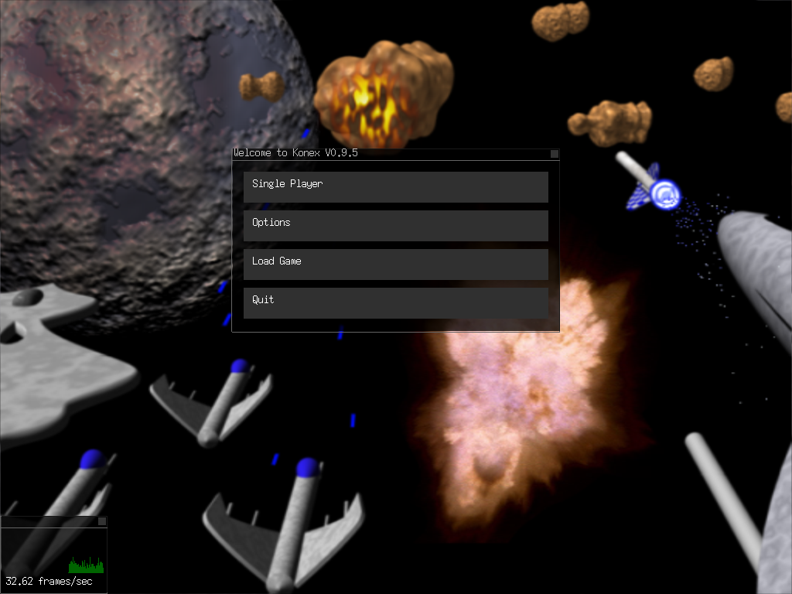

*Picture 1. The main menu over the Conex logo, right after launch.*

1. The menu window's title is built from `SYS_APPNAME` and `SYS_APPVERSION`: "Welcome to Konex V0.9.5".
2. Four choices: Single Player, Options, Load Game, Quit. A Multiplayer entry exists in `menu.cpp` but is commented out.
3. Bottom left: the frame-rate window (part 6), on because the shipped `config.xml` sets `ShowFPS` to 1.

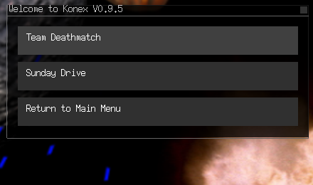

*Picture 2. Single Player: Team Deathmatch, Sunday Drive, Return to Main Menu.*

Options leads to Display (toggle the FPS window and, in a game, the mini map, HUD and target window) and Player (type a name). A Video page with four resolutions and a fullscreen toggle is written but commented out of the Options menu.

**Check yourself.**
- Where does the menu's title text come from? (Two `#define`s in `defs.h`.)
- Why is the logo only drawn when `gameRunning` is false?

## 2. Two scenes: Team Deathmatch and Sunday Drive

**Why it exists.** A *scene* says which map to load and who is in it. Keeping scenes in XML (`dist/deathmatch.xml`, `dist/sundaydrive.xml`) means a new game mode is a new file, not new code.

**How it fits.** `game_LoadScene()` reads the scene, which names a map; `game_LoadMap()` reads the map's size, planets and spawn points; then the player's own ship is created from `config.xml` (ship 12, Yodacon, team 1, in the shipped file) at the centre of the map.

| Scene | Map | Who is in it |
| --- | --- | --- |
| Team Deathmatch | `data/maps/triforce.xml`: 10000 × 10000, 13 planets (three per team plus four neutral), 9 spawn points (three per team) | 36 computer pilots: each of the 12 ships once on each of the three teams, starting at their team's corner |
| Sunday Drive | the same map | nobody: just you, the planets and the stars |

A second map, `solarsys.xml`, is in the data but no scene uses it.

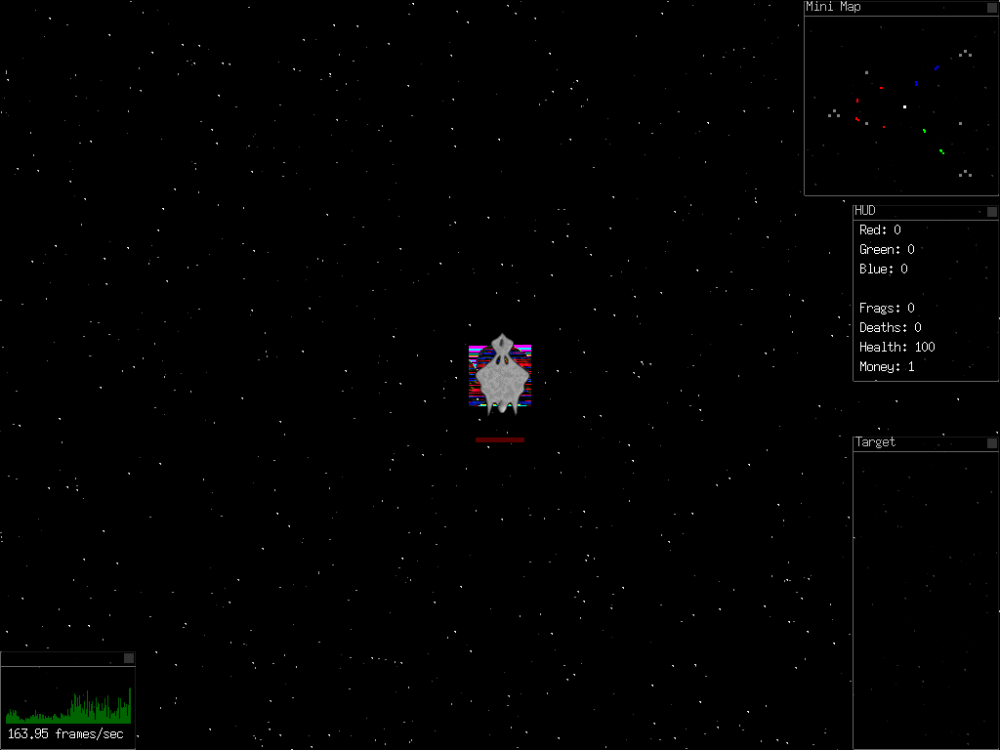

*Picture 3. Team Deathmatch, three seconds after it starts.*

1. Your ship, the Yodacon, at the centre of the map, with its red (team 1) health bar under it. The coloured noise behind it is a planet: the neutral planet at the map's centre uses sprite 14 (`data/planets/13/pic.tga`), and that file decodes as noise (ImageMagick shows the same, picture 10).
2. Mini map, top right: the three teams' ships as red, green and blue dots, planets grey, you white.
3. HUD: team scores, your frags, deaths, health and money.
4. Target window, empty until you lock a target (part 4).

**Check yourself.**
- What would a third scene need? (One XML file and one menu entry.)
- Why do all 36 pilots appear at only three places? (Each team's actors share one `xpos`/`ypos` in `deathmatch.xml`.)

## 3. Flying: thrust, turn, drift, and the arrow-key problem

**Why it exists.** The feel of the game is momentum: you point, you thrust, and you keep drifting until you do something about it.

**How it fits.** Every frame, `entities_ProcessMovement()` moves every entity by its velocity, and `player_ProcessInGame()` clamps the speed to the ship's `MaxVelocity`, bounces the ship off the map's edges, and recharges one point of health every three seconds. The ship's numbers come from its `specs.xml` (part 9).

| Key (as the code means it) | Does |
| --- | --- |
| Left / Right arrow | turn at the ship's `TurnSpeed` (degrees per second) |
| Up arrow | thrust along the heading at the ship's `Acceleration` |
| Down arrow | thrust backwards |
| Insert / keypad 0 | brake: divides the velocity by (1 + frame time) each frame |
| Space | fire (part 4) |
| Left Shift | lock the nearest enemy as the target |
| Left Ctrl | toggle auto-aim at the target |
| Tab | full map |
| Escape | the in-game menu, and pause |
| ` (backquote) | the console (part 8) |

Nothing slows the ship but the brake key: there is no drag.

**The arrow-key problem.** The Linux key table (`src/in_linux.h`) is a list of raw X11 key *codes* from 2005: Up 98, Down 104, Left 100, Right 102. A modern X server (here XWayland with the evdev layout) gives the arrows the codes 111, 116, 113 and 114, and puts Katakana, KP_Enter, Henkan and Muhenkan at the old numbers. So on a modern Linux desktop **the arrow keys do nothing**. Measured: holding Up for 1.5 s left `loc` at 5000.00, 5000.00 with velocity 0; holding the key whose code is 98 moved the ship to 4616.71, 6165.57. Keys whose codes did not change (Escape, Tab, Space, Shift, Ctrl, backquote, Enter, the letters) work. The flight in picture 4 was flown by sending codes 98, 100 and 90 with `xdotool`. The macOS build feeds SDL scancodes into the Windows key table (`in_win.h`); that path was not tested here.

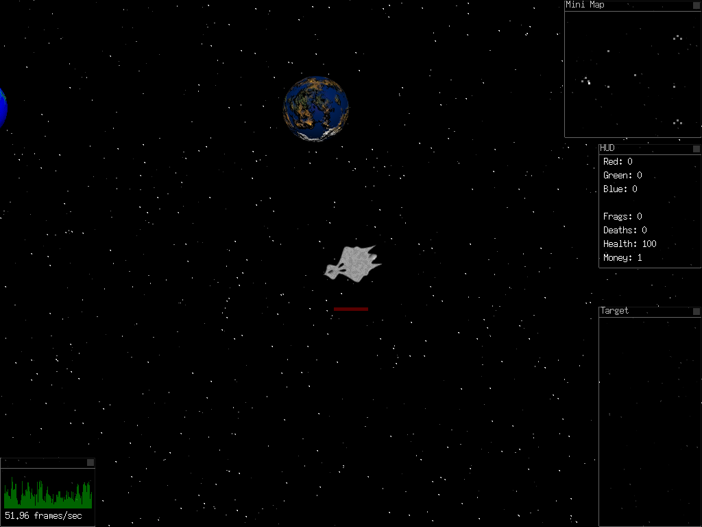

*Picture 4. Sunday Drive: the Yodacon after turning left, thrusting for 1.25 s, coasting and braking, next to a team-1 planet at (1500, 4500).*

1. The planet sprite, drawn at its world position; the view keeps your ship at the centre of the window.
2. The stars are 1000 points (`StarCount` in `config.xml`) that slide against your motion, faster for brighter stars, to give parallax.
3. The mini map shows only planets: Sunday Drive has no other ships.

**Check yourself.**
- Why does the ship keep moving after you let go of thrust?
- Which key codes would need to change for the arrows to work on a modern X server?

## 4. Combat: missiles, targets, frags and respawns

**Why it exists.** It is a deathmatch: the score is kills, by player and by team.

**How it fits.** A missile is just another entity. It starts at the ship's position with the ship's velocity plus 2000 units/s along the heading, lives 2 s, and on touching a ship of another team takes that ship's `Damage` value off its health (there is no friendly fire). A kill adds a frag to the shooter and a point to the shooter's team, prints "*killer* killed *victim*" at the top left for five seconds, leaves a 17-frame explosion, has a one-in-five chance of dropping a pickup (health or money, lasting 15 s), and respawns the victim at one of its team's spawn points with full health. Space fires at most every 0.2 s.

Left Shift locks the nearest enemy; the game draws white corner brackets around it and a red line to it from the centre of the screen, and the Target window shows who it is. Left Ctrl turns on auto-aim, which turns your ship to face the target each frame.

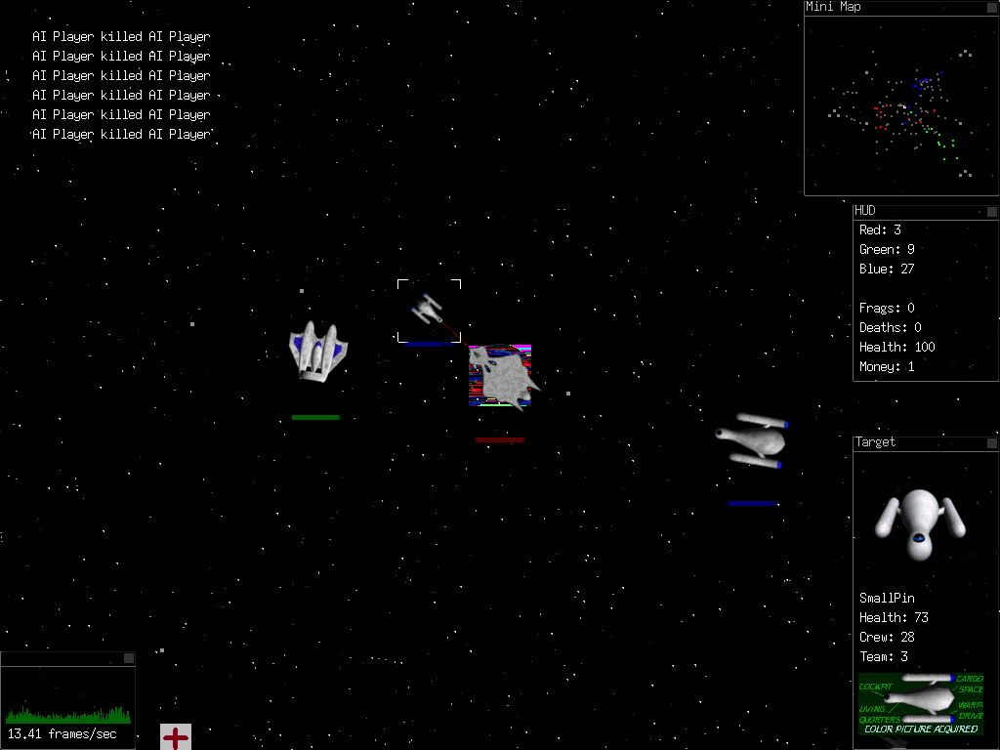

*Picture 5. About ten seconds into Team Deathmatch, with a target locked and auto-aim on, Space held.*

1. Kill notices, newest at the bottom.
2. The locked target in its brackets, with the red line from the centre.
3. Target window: the ship's comm portrait, name (SmallPin), health 73, crew 28 (a random 1–50 given at creation), team 3, and its schematic.
4. HUD: the team scores already stand at Red 3, Green 9, Blue 27.
5. A health pickup (the red cross) left by a destroyed ship.
6. The frame rate fell to about 13 frames/s during this fight on software rendering, against 130–160 in an empty sky.

The shipped `config.xml` turns on `GodMode`, so your own ship takes no damage until you type `god` in the console.

**Check yourself.**
- Why does a missile fired from a fast ship fly faster?
- What does a kill change on the screen? (Notice, explosion, HUD scores, perhaps a pickup.)

## 5. Three teams of computer pilots

**Why it exists.** A deathmatch for one person needs opponents. Every actor in the scene file becomes a computer pilot.

**How it fits.** `player_CreateAI()` gives each pilot one of two behaviours, at random, as a function pointer the movement loop calls each frame (`src/ai.cpp`):

| Behaviour | What it does |
| --- | --- |
| `ai_Rabbies` | find the nearest enemy, turn toward it, fire when within 1024 units, thrust when farther than 512 |
| `ai_Seige` | the same, but brakes when closer than 512 instead of coasting through |

Both steer with `ai_FaceEntityAtPoint()`, the same routine your auto-aim uses. Two touring behaviours (`ai_TourPlanets`, `ai_TourGalaxy`) are written but not assigned to anyone. Teams fight teams, so the 36 pilots fight each other as well as you: the HUD scores in picture 5 climb while your own frags stay at 0.

## 6. The window system: map, HUD, target, frame rate

**Why it exists.** The game needs several panels of information at once, and the player may want them elsewhere or gone. konex has its own small window manager, drawn in OpenGL: each panel has a title bar, a frame, a translucent black background and a close box, and can be dragged with the mouse.

**How it fits.** `interface.cpp` creates every window at start-up and shows or hides them; the menu, the ship picker and the maps are all windows. The settings `ShowHUD`, `ShowTarget`, `ShowMiniMap` and `ShowFPS` in `config.xml` decide which are open when a game starts, and the toggles in Options and the console change them.

| Window | Shows |
| --- | --- |
| Mini Map | every entity as a dot: team colour for ships, grey planets, white for you, red for your target |
| Full Map (Tab) | the same, large; drawn over the play area |
| HUD | Red, Green, Blue team scores; your frags, deaths, health and money |
| Target | the locked ship's portrait, name, health, crew, team and schematic |
| frame-rate window | frames per second and a 128-sample history graph |
| Select Ship | part 7 |
| Planet, View Sprite | written for landing and for viewing sprites; nothing opens Planet, and View Sprite (console `viewsprite`) draws nothing |

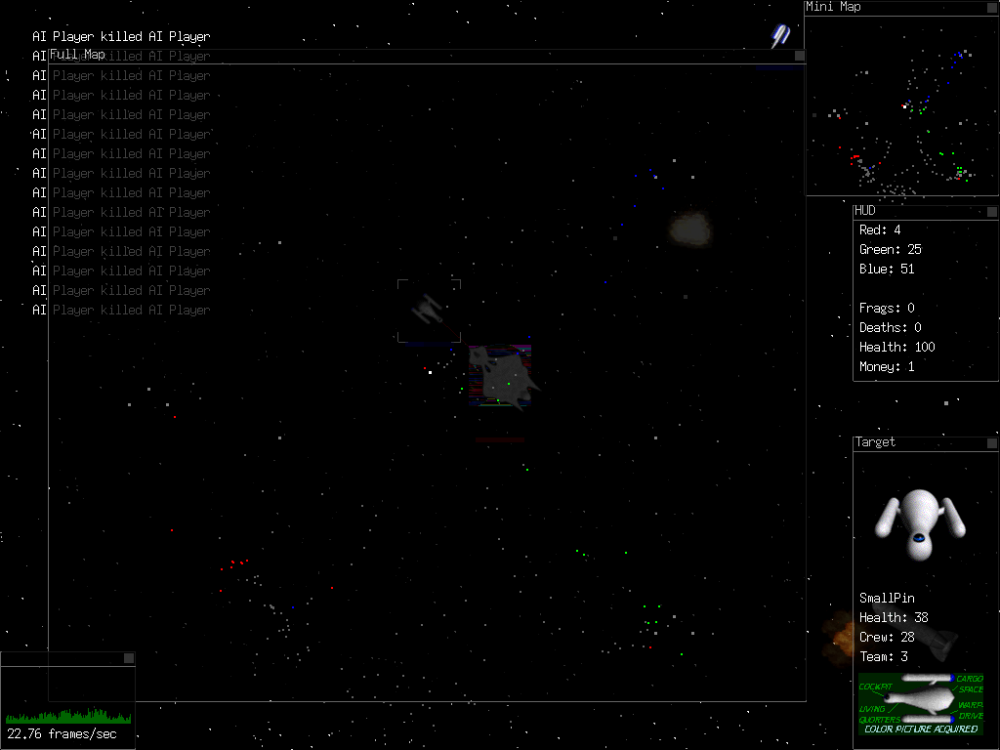

*Picture 6. The full map (Tab) over a running battle.*

1. The map window: the three teams' dots spread from their corners toward the middle, where the fighting is.
2. Behind it the game keeps running; the mini map shows the same picture small.

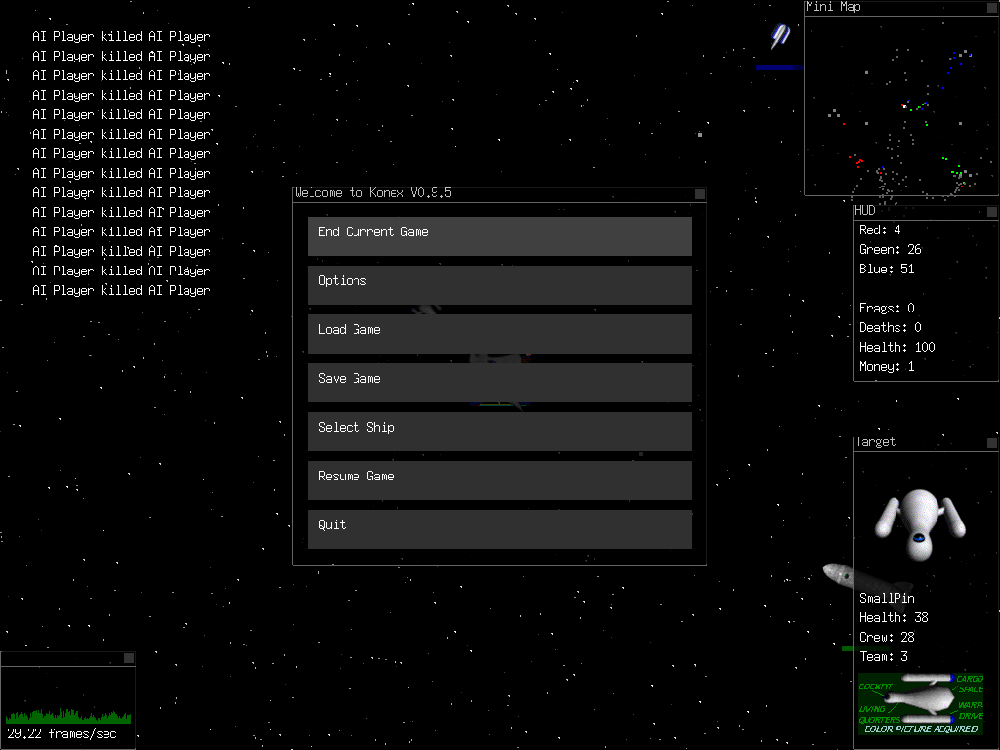

*Picture 7. The in-game menu (Escape), which pauses the game.*

1. End Current Game, Options, Load Game, Save Game, Select Ship, Resume Game, Quit.
2. Save and Load exist but save only the team scores and a pointer (part 10).

## 7. Picking a ship

**Why it exists.** Twelve ships with different speeds, turn rates and acceleration make the choice of ship part of the game.

**How it fits.** The picker reads the `ships[]` table, which `ships_Init()` filled from each ship's folder (part 9). Clicking a ship gives it to your player at once and stores its number as `PlayerShipID` in `config.xml`, so the next game starts in it.

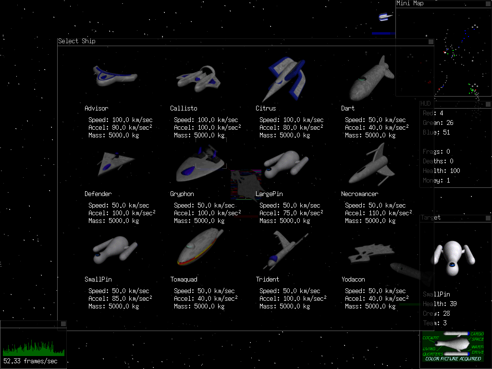

*Picture 8. Select Ship (from the in-game menu): the twelve ships with their shipyard pictures and numbers.*

1. Each ship's `yard.tga`, dimmed until the mouse is over it.
2. Speed and acceleration are `MaxVelocity` and `Acceleration` from `specs.xml` divided by ten and labelled km/s and km/s²; mass is shown as written (5000 kg for every ship).

| Ship | MaxVelocity | TurnSpeed | Acceleration | Damage |
| --- | --- | --- | --- | --- |
| Advisor | 1000 | 220 | 900 | 100 |
| Callisto | 1000 | 260 | 1000 | 1 |
| Citrus | 1000 | 280 | 800 | 1 |
| Dart | 500 | 200 | 400 | 1 |
| Defender | 500 | 220 | 1000 | 1 |
| Gryphon | 500 | 220 | 1000 | 1 |
| LargePin | 500 | 220 | 750 | 1 |
| Necromancer | 500 | 220 | 1100 | 10 |
| SmallPin | 500 | 220 | 850 | 1 |
| Tomaquad | 500 | 220 | 400 | 1 |
| Trident | 500 | 220 | 1000 | 1 |
| Yodacon | 500 | 220 | 400 | 1 |

(From `dist/data/ships/*/specs.xml`. Every ship's `Mass` is 5000. The Advisor's missiles do 100 damage, a one-shot kill; the Necromancer's do 10; every other ship's do 1. Each file also has a `CollisionRadius`, but collisions are tested at a fixed 64 units.)

## 8. The console

**Why it exists.** A developer's tool left in the game: a drop-down console for looking inside the running game and changing it without a rebuild.

**How it fits.** Every message the engine prints goes both to the terminal and to the console's 255-line buffer, so the console is also the game's log. Backquote slides it down (270 pixels, 16 lines shown); Page Up and Page Down scroll (with the 2005 key codes, see part 3), Up recalls the last command.

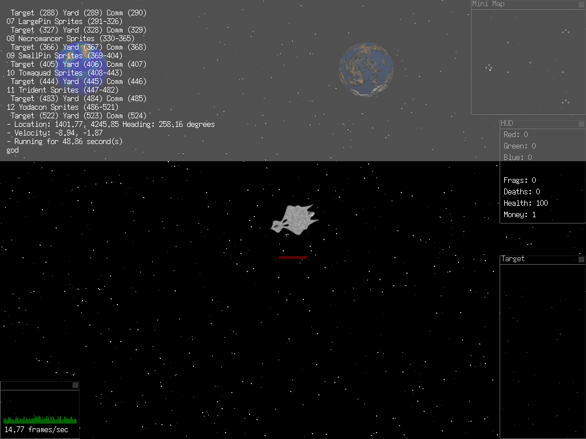

*Picture 9. The console over Sunday Drive, after `listships`, `loc` and `uptime`, with `god` typed but not yet entered.*

1. `listships`: each ship's number, name and the image numbers of its 36 sprites, target, yard and comm pictures.
2. `loc`: position, heading and velocity.
3. `uptime`: seconds since start.
4. The command line at the bottom.

| Command | Does |
| --- | --- |
| `quit` (also `exit`, `end`, `bye`, `close`, `q`) | quit, saving `config.xml` |
| `loc` (also `nav`, `where`, `location`, `coord`, `coordinates`) | position, heading, velocity |
| `stat`, `uptime` | health and kills; time since start |
| `god` | toggle god mode |
| `spawn` | add one computer pilot |
| `team N`, `playership N` | change your team or ship |
| `starcount N` | rebuild the star field |
| `fps`, `hud`, `minimap`, `target`, `viewsprite`, `showfps` | toggle windows and readouts |
| `listships`, `listplanets`, `listentities`, `viewentity N` | inspect; `viewentity` moves the camera to another entity |
| `shipturnspeed`, `shipmaxvelocity`, `shipacceleration` *id value* | tune a ship while flying it |
| `saveship N`, `saveships`, `loadship folder` | write tuned numbers back to `specs.xml`, or load a ship folder |
| `bmp2tga file` | convert a BMP to the game's TGA format |
| `savegame`, `loadgame`, `aicount N`, `chat`, `startserver`, `connect` | present; the network ones do nothing (part 10) |

**Check yourself.**
- How would you make the Yodacon turn faster and keep the change? (`shipturnspeed 12 300`, then `saveship 12`.)

## 9. Data, not code: XML and TGA files

**Why it exists.** Ships, maps, scenes and settings are files, so the game can be changed and extended without recompiling, and the console's tuning commands can write their results back.

**How it fits.** Everything under `dist/` is copied next to the executable by the build, and the engine finds it relative to the executable's own path (or a path given as the one argument). XML is read and written with TinyXML, bundled in `src/tinyxml/`.

| File(s) | Holds |
| --- | --- |
| `config.xml` | player name, star count, which windows are open, god mode, ship, server address, team; saved on quit |
| `deathmatch.xml`, `sundaydrive.xml` | scenes: a map and a list of actors |
| `data/maps/*.xml` | map size, planets, spawn points |
| `data/ships/<name>/` | `specs.xml`, 36 rotation frames `00.tga`–`35.tga`, and `yard.tga`, `comm.tga`, `target.tga` |
| `data/planets/00`–`17/` | `pic.tga` (the sprite in space) and `view.tga` (a 256×256 view; missing for 13–17, as the start-up log shows) |
| `data/explosions/`, `data/items/` | 17 explosion frames; the health and money pickups |
| `data/fonts/font.bmp`, `data/logos/conex.tga`, `data/icons/` | font, title logo, icon |
| `data/models/*.x`, `data/sounds/*.wav` | 3D models and test sounds for subsystems that are not switched on (part 10) |

A ship is drawn as one of 36 pre-rendered pictures, chosen by heading in 10° steps, rather than rotated in OpenGL.

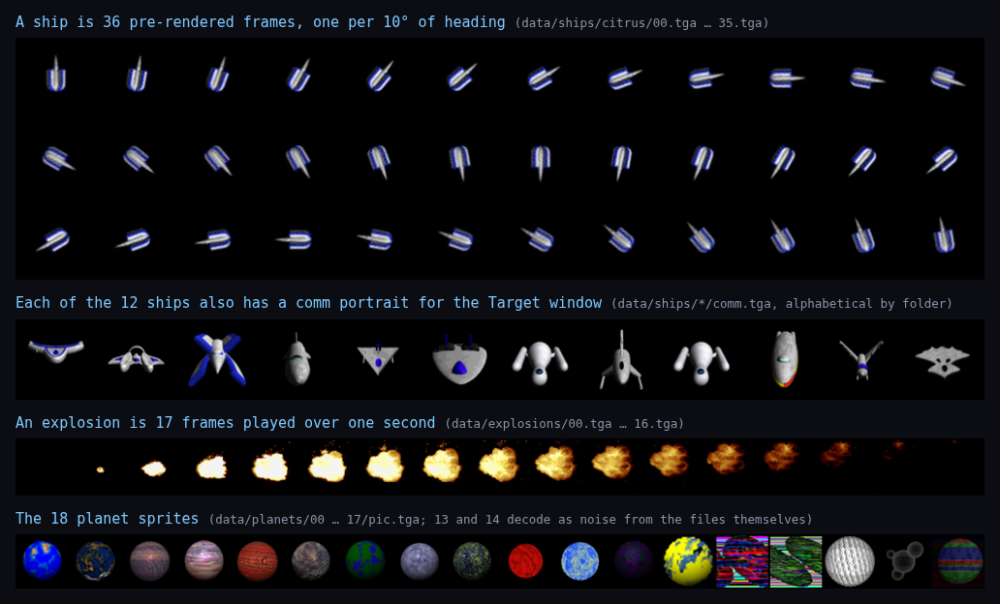

*Picture 10. The repository's own sprite files on one sheet (converted from TGA with ImageMagick, not captured from the game).*

1. The Citrus's 36 rotation frames.
2. The twelve comm portraits, in the order of the ship folders.
3. The 17 explosion frames, played over one second.
4. The 18 planet sprites. Numbers 13 and 14 decode as noise from the files themselves; 13 is the one behind the Yodacon in picture 3.

## 10. What was left unfinished in 2005

**Why it matters.** The repository is a snapshot of work in progress (it was committed in 2023 "from old backup"). Several subsystems are written but not connected, and knowing which saves time.

| Part | State in the code |
| --- | --- |
| Multiplayer | `net_main.cpp` has a TCP server and client on port 5050 for up to ten clients; `net_Init`/`net_Frame` are commented out of `sys_main.cpp` and the Multiplayer menu entry is commented out |
| Sound | `snd_main.cpp` uses OpenAL; it is in no build's source list and its calls are commented out |
| Landing on planets | the landing routine and its Right Ctrl key are commented out; the Planet window is never opened |
| 3D models | `vid_model.cpp` reads `.x` models; the calls that load and draw them are commented out |
| Save and Load | write and read `save.dat` with the three team scores and the in-memory address of your ship, not the game state |
| Clearing a game | `player_Clear`, `missile_Clear` and `explosion_Clear` have their bodies commented out, so End Current Game leaves the old ships in the world: a Sunday Drive started after a deathmatch, in this session, still had the battle in it |
| Video modes | the resolution page is written but commented out of Options |

## 11. Building it: 2005 Autotools to the 2026 port

**Why it exists.** A 2005 game builds against 2005 tools. The `macos-port` branch makes it build again on current macOS and Linux without rewriting the game.

**How it fits.** The engine is split by prefix: `sys_`, `vid_`, `in_`, `tm_` (timer), `net_`, `snd_`, with one file per platform where it matters: `sys_linux`/`sys_win`, `vid_linux` (X11 + GLX), `vid_win32`, `vid_sdl`, `tm_linux`/`tm_win32`. The game files (`game`, `player`, `ai`, `missile`, …) call only the engine's functions, so a port is a new `vid_` backend plus build glue.

What the history shows:

- **2005.** The `CVS/` folders record a CVS repository on `2nd-gen.net` with files dated July and August 2005. The tree carries three build systems: Autotools (`Makefile.cvs`, `configure.in`, version 0.1), a Visual C++ 6 project (`konex.dsp`/`.dsw`, with a `Release/` folder holding a built `konex.exe` and its object files), and a KDevelop project. `dist/konex.exe` is a Windows build too.
- **2023-10-03.** Joshua Bussdieker commits the tree to Git "from old backup".
- **2026-08-27.** Paul Richeson's port commits (the commit trailers credit Claude as co-author): CMake replaces Autotools as the real build, with per-platform source lists and a step that copies `dist/` next to the binary; the dead SDL 1.2 backend is rewritten for SDL2 for macOS; a `Makefile` front end adds `make`, `make run`, `make release`, `make check`, `make deps`, `make help`.
- **2026-09-04.** The Linux build stops requiring OpenAL and freealut (which Alpine does not package) for a sound system that is not compiled; a loop in the frame-rate graph that read one past the end of its array is fixed; `make deps` and `make check` learn Alpine. The commit records it building and running at about 70 frames/s on Alpine under XWayland with llvmpipe.

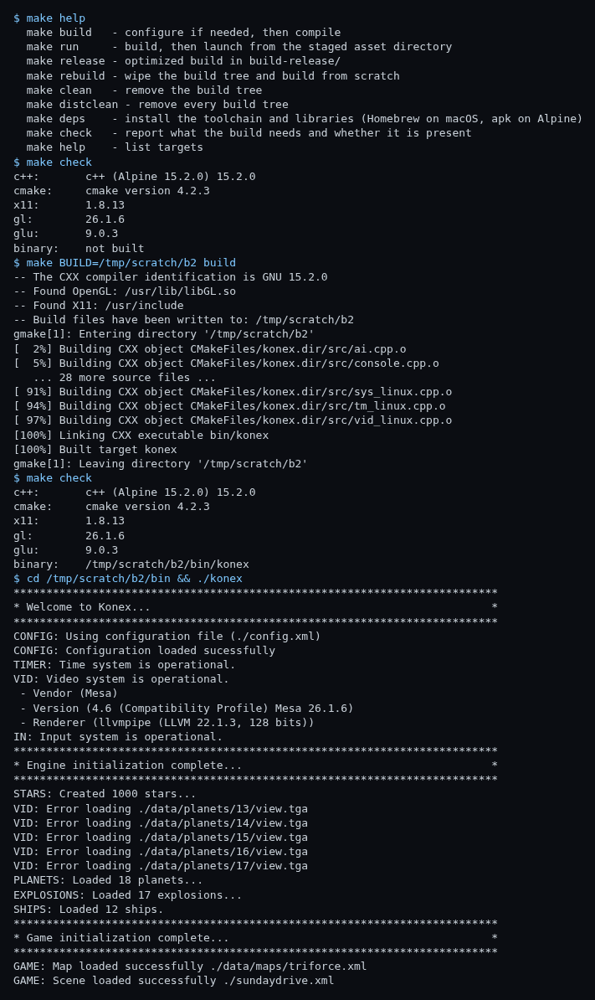

*Picture 11. The build on 2026-10-20, from `make help` and `make check` to the game's start-up log (real output; the scratch build path is shortened to /tmp/scratch, and the per-file compile lines are elided).*

1. `make check` lists what the Linux build needs: a C++ compiler, CMake, and the X11, GL and GLU headers.
2. The build is clean apart from six compiler warnings in the 2005 code.
3. The start-up log: configuration, video (Mesa llvmpipe), 1000 stars, 18 planets, 17 explosions, 12 ships; five planets have no `view.tga`.

To build and play: `make deps` (prints the packages), `make`, `make run`. Run from the build directory, the game opens a 1024×768 window and grabs the keyboard; quit from the menu or with `quit` in the console.

## 12. How it fits together

| Part | Files | Why it exists | Connects to |
| --- | --- | --- | --- |
| Start-up and main loop | `sys_linux.cpp`, `sys_main.cpp`, `konex.cpp` | find the data, start the engine, run a frame | everything |
| Menu | `menu.cpp` | start, choose, quit, pause | scenes, window system |
| Scenes and maps | `game.cpp`, `map.cpp`, `spawn.cpp`, `*.xml` | say what is in a game, in data | entities, AI |
| Entities | `entity.cpp` | one list of 400 slots for ships, missiles, explosions, planets, spawns, pickups; one movement loop | every game part |
| Flight | `player.cpp`, `in_main.cpp`, `in_linux.h` | momentum, turn, thrust, brake | ships, view |
| Combat | `missile.cpp`, `explosion.cpp`, `item.cpp`, `target.cpp` | shoot, score, respawn, pick up | HUD, console notices |
| Computer pilots | `ai.cpp` | opponents for one player | entities, combat |
| Window system | `interface.cpp` | panels that can move and close | map, HUD, target, ship picker, menu |
| Ships | `ships.cpp`, `data/ships/` | twelve tuneable ships | picker, flight, console |
| Console | `console.cpp` | log, inspect, tune | almost everything |
| View and stars | `view.cpp`, `stars.cpp`, `planets.cpp` | keep you centred, give a sense of motion | drawing |
| Engine backends | `vid_*.cpp`, `tm_*.cpp`, `vid_image.cpp` | draw, time and load images per platform | the port |
| Build | `CMakeLists.txt`, `Makefile` (2026); Autotools, VC6, KDevelop files (2005) | build it then and now | the port |
| Not connected | `net_main.cpp`, `snd_main.cpp`, `vid_model.cpp` | multiplayer, sound, 3D models | nothing yet |
